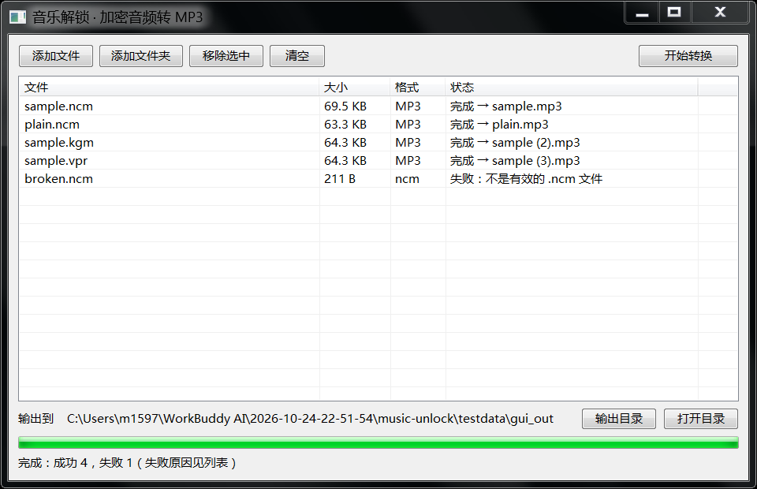

# 音乐解锁 · MusicUnlock

把你花钱开 VIP 下载下来、却只能在某个 App 里播放的加密音频，转成车机、U 盘、老播放器都能放的 **MP3**。

原生 C 写的 Windows 程序，**单文件 80 KB，静态链接，不需要 Python、不需要运行库**，双击就用。



---

## 支持的格式

| 格式 | 来源 | 状态 |
|---|---|---|
| `.ncm` | 网易云音乐 | ⚠️ 仅经典版（见下方说明） |
| `.kgm` / `.kgma` | 酷狗音乐 | ✅ 完整支持 |
| `.vpr` | 酷狗 VIP | ✅ 完整支持 |
| `.qmc0/.qmc3/.qmcflac/.qmcogg` | QQ 音乐（QMCv1） | ❌ 暂不支持 |
| `.mflac` / `.mgg` | QQ 音乐（QMCv2） | ❌ 暂不支持 |
| `.kwm` | 酷我音乐 | ❌ 暂不支持 |

QQ 音乐和酷我那几种格式的密钥表我没能拿到可交叉验证的版本。与其凭印象写一张可能错位的表、最后给你输出一堆杂音，不如明确标成不支持 —— 工具会直接告诉你"暂不支持"，而不是生成一个坏文件。

> **NCM 新版变体的已知限制**
>
> 网易云客户端 3.x（实测 3.1.42）下载的部分 `.ncm` 换了音频段加密方式。这类文件：
>
> - 容器结构、元数据（歌名/歌手/专辑）、内嵌封面**都能正常解析**
> - 但音频段不是经典 RC4 密钥流，**目前解不出来**
>
> 程序会明确报"密钥已解出，但音频段不是已知算法（新版 NCM 变体，暂不支持）"，并且不产出任何文件。
>
> 已排除的可能性：密钥长度 1–111 全枚举、MD5/SHA1/SHA256/Base64 派生、周期 256 块模式（相位 0/163/255）、连续 RC4 流（drop 0/768/1024/3072/4096）、流从文件头连续推进。用 MP3 帧间隔统计检验（正确解密应在 1044 附近密集命中数百次）判定，以上全部不成立。


## 怎么用

1. 双击 `MusicUnlock.exe`
2. 把加密音频**拖进窗口**，或点「添加文件 / 添加文件夹」
3. 选好输出目录（默认 `音乐\已解锁`）
4. 点「开始转换」

转换完的 MP3 会自动带上歌名、歌手、专辑和内嵌封面（网易云的文件里有这些信息）。

也支持命令行 / 右键"发送到"：

```
MusicUnlock.exe -o "D:\车机U盘" "歌1.ncm" "歌2.kgm"
```

批量或脚本场景可以用同目录下的 `unlock-cli.exe`：

```
unlock-cli.exe -o 输出目录 文件1 文件2 ...
```

## 关于 ffmpeg

- 如果解密出来的**本来就是 MP3**（大部分 `.qmc0`、部分 `.ncm`）→ 直接写盘，不需要任何外部程序
- 如果解出来是 **FLAC / OGG / WAV**（无损音质）→ 需要 `ffmpeg.exe` 转成 MP3

程序会依次在「自身所在目录 → PATH → 常见安装位置」里找 `ffmpeg.exe`。找不到时会明确提示，不会静默失败。想省事就把 `ffmpeg.exe` 和本程序放同一个文件夹。

## 它不会给你坏文件

解密结果写盘前会做**文件头魔数校验**（`ID3` / `fLaC` / `OggS` / `RIFF` / MPEG 帧同步字）。校验不过就判定失败、删除临时文件、在列表里显示原因 —— 绝不会留下一个"看起来转换成功但打不开"的文件。

NCM 的音频流有两套已知的密钥流变体，程序会**两种都试**，以能通过魔数校验的那个为准。

## 自己编译

需要 MinGW-w64（gcc）：

```bat
build.bat
```

或者手动：

```bat
windres res\app.rc -O coff -o build\app.res
gcc -O2 -s -static -municode -mwindows -o MusicUnlock.exe ^
    src\main.c src\convert.c src\dec_ncm.c src\dec_kgm.c ^
    src\audio.c src\id3.c src\util.c src\aes.c build\app.res ^
    -lcomctl32 -lshell32 -lshlwapi -lole32 -luuid -lcomdlg32 -lgdi32 -luser32
```

## 目录结构

```
src/
  main.c       Win32 界面（列表、拖拽、线程、进度）
  cli.c        命令行入口 / 自检
  convert.c    解密 → 判格式 → 转码 → 打标签 的流水线
  dec_ncm.c    网易云 .ncm
  dec_kgm.c    酷狗 .kgm/.kgma/.vpr
  aes.c        AES-128（S 盒由 GF(2^8) 逆元实时推导，不抄表）
  id3.c        ID3v2.3 标签写入（UTF-16 文本 + APIC 封面）
  audio.c      魔数识别、ffmpeg 调用
  util.c       路径 / Base64 / 文件工具
tools/
  make_tests.py  生成人造加密文件（用于回归测试）
  gui_test.py    界面端到端测试
  shot.py        窗口截图
```

## 测试情况

用「先按算法正向加密、再用本程序解回来、逐字节比对」的方式验证过：

- `.ncm`（带元数据 / 无元数据）、`.kgm`、`.vpr` 解密后音频负载与原文件**逐字节一致**
- FLAC 源 → ffmpeg 转 MP3，时长/标签/封面正确
- 中文 + 空格 + 括号的路径正常
- 损坏文件被拒绝，不产生输出

## 免责

只用于处理你**本人已合法获得**的音频文件，做个人设备间的格式转换。别拿去传播、分发或商用。各平台的服务条款怎么规定，请自行遵守。

## 许可证

[MIT](LICENSE)。算法常量的出处见 [NOTICE.md](NOTICE.md)。
